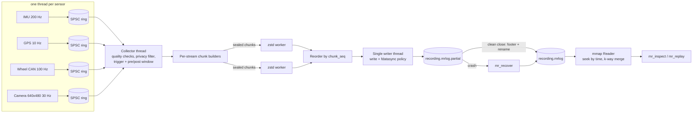

# MiniRecorder

A multi-threaded sensor data recorder and replay tool in C++20, in the spirit
of a small rosbag/MCAP recorder, built around a crash-safe, append-only log
storage engine.

Autonomous-vehicle data collection has two jobs that pull in opposite
directions: sensors must never be blocked (a stalled IMU driver is worse than
a lost camera frame), and the data that was captured must survive a crash or
a power cut in the vehicle. MiniRecorder takes simulated IMU, GPS, wheel-speed
CAN and camera streams, moves them through lock-free per-sensor rings, checks
data quality, optionally records only around events such as a hard brake,
masks privacy-sensitive data, and writes CRC-protected compressed chunks that
can be recovered after `kill -9`.

All sensor data in this repository is **synthetic**, produced by the built-in
simulator (a KITTI OXTS replay source is included for real IMU/GPS data, but
the dataset is not part of the repository).

## Architecture



* **Producers** generate payloads directly into a preallocated ring slot; no
  allocation on the hot path. Each stream has its own overflow policy:
  `drop-newest`, `drop-oldest` or `block`, with every loss counted.
* **Collector** copies each record out (releasing the slot at once), runs
  sequence-gap / timestamp-regression / rate / staleness checks, applies the
  privacy filter (GPS precision, camera ROIs), and either writes continuously
  or keeps a rolling pre-trigger window and records `pre + post` seconds
  around hard-brake (or optional quality-fault) triggers.
* **Storage engine**: per-stream chunks (1 MiB or 500 ms), compressed in
  parallel, written strictly in order by one thread; every chunk has a
  CRC-protected header and a body CRC; the footer holds the chunk index and
  per-stream statistics. Files are `.partial` until a durable footer exists,
  then atomically renamed. The byte layout is in [docs/FORMAT.md](docs/FORMAT.md).
* **Reader**: memory mapped, O(log n) seek by time per stream, merged
  iteration across streams with a binary heap.

[docs/DESIGN.md](docs/DESIGN.md) covers the threading model, memory
orderings, back-pressure, durability rules and failure modes in depth.

## Results

Reference machine: 2 vCPU Intel Xeon @ 2.10GHz (KVM guest, shared), 7 GiB
RAM, ext4 on a virtio block device (physical media not visible to the guest),
GCC 13.3 `-O3`. Full tables, raw JSON and machine details are in
[bench/results](bench/results/RESULTS.md); reproduce with
`bench/run_micro.sh && bench/run_e2e.sh && bench/summarize.py`.

| What | Result | Source |
|---|---|---|
| SPSC ring vs `std::mutex` + `std::queue`, 64 B messages, 1 producer / 1 consumer | **15.8 M vs 2.95 M msg/s (5.4x)**; condition-variable queue 2.1 M/s | `micro_ring.json` |
| Round trip through two queues (ping-pong) | SPSC p50 **522 ns** / p99 673 ns; mutex p50 2,185 ns / p99 19,286 ns | `micro_ring.json` |
| CRC32C, 1 MiB | slice-by-8 1.75 GB/s, SSE4.2 4.81 GB/s | `micro_codec.json` |
| End-to-end, all four sensors unpaced, lossless (`--policy all=block`) | zstd 1: **320 MB/s in, 271 MB/s to disk**; zstd 3: 175 / 139 MB/s; zstd 9: 58 / 39 MB/s | `throughput_zstd*.json` |
| End-to-end, small records only (camera off) | **3.12 M records/s** at zstd 1, 2.24 M at zstd 3, 1.32 M at zstd 9 | `throughput_small_zstd*.json` |
| Enqueue-to-durable latency at nominal rates, fsync per chunk, 50 ms chunk age | p50 **32.8 ms**, p99 67.1 ms (585 fdatasync in 10 s) | `durability_chunk_age50.json` |
| Same with fsync every 100 ms / only at close | p50 86.3 / 5,097 ms, p99 165 / 9,997 ms | `durability_*_age50.json` |
| Recovery after SIGKILL, 1.15 GB `.partial`, cold cache | full verify (decompress every chunk) 2.55 s (2.2 s/GB); CRC only 0.84 s (0.73 s/GB) | `recovery_1GB.json` |
| Overload: sensors at 30x nominal into zstd 9 | exact accounting, e.g. drop-newest IMU 29,979 produced = 12,432 persisted + 17,547 dropped | `overload_*.json` |
| Replay at 1x, schedule lateness | sleep only: p50 111 us, p99 2.07 ms; with 200 us spin: p50 0.5 us, p99 1.73 ms | `replay_1x_*.json` |

Compression ratios (uncompressed record bytes / bytes on disk) in the
end-to-end runs at zstd 1 / 3 / 9: IMU 1.40 / 1.39 / 1.38, GPS 1.85 / 1.87 /
1.91, wheel CAN 2.89 / 3.11 / 3.23, camera 1.13 / 1.26 / 1.50. The camera
generator produces smooth multi-octave noise panned across frames plus small
per-pixel sensor noise, so frames are neither random nor constant; it is
still synthetic, and zstd is not an image codec, so treat these ratios as
indicative only.

Correctness checks (`bench/results/verification.txt`): 94 CTest tests (93
GoogleTest cases plus the end-to-end script) pass with GCC and Clang Release,
ASan+UBSan and TSan; clang-format and clang-tidy (bugprone, cppcoreguidelines,
performance, concurrency, clang-analyzer, ...) are clean on the library and
tools; the libFuzzer target ran 4.0 M inputs in 60 s with ASan+UBSan without
findings.

## Design decisions and trade-offs

**One SPSC ring per producer.** Each sensor has exactly one producer and the
collector is the only consumer, so a single-producer/single-consumer ring
needs no read-modify-write instructions on the fast path: one acquire load
and one release store per operation, with each index on its own cache line.
An MPSC queue would put all sensors on one contended tail, and a mutex queue
costs 5.4x in throughput and about 29x in p99 round-trip latency here (table
above). Rings also give
per-stream overflow policies and per-stream loss counters for free.

**Fixed-size slots, filled in place.** Slot memory is allocated once; a
camera frame is generated straight into its slot. The cost is memory for the
largest payload times capacity (16 slots of 307 KB for the camera), which is
an explicit, bounded budget.

**Memory ordering.** Release on publish, acquire on observe, relaxed on the
owner's own index: that is the minimum that orders slot contents with the
index updates, and sequential consistency would only add fences. Drop-oldest
is the subtle case because the producer must advance the consumer's index;
the consumer claims a slot with a lock bit before reading it, and the
producer only evicts unlocked slots. The protocol and its argument are in
[DESIGN.md](docs/DESIGN.md#drop-oldest-makes-tail_-a-two-writer-variable), and
a stress test checks it under ThreadSanitizer.

**Parallel compression, single ordered writer.** zstd is the CPU bottleneck,
so chunks are compressed by a worker pool, but exactly one thread writes, in
`chunk_seq` order, through a reorder buffer. The file is therefore always a
valid prefix plus at most one torn chunk, there is no locking around the file
offset or index, and recovery is a forward scan.

**Chunk-level CRC.** The chunk is the unit of compression, writing and
recovery, so it is the unit of integrity: one CRC over the stored body plus a
separate CRC over the header, so size fields are trusted only after their
own check. Per-record CRCs would add 4 bytes to every 48-byte IMU sample; a
per-file CRC could not localize damage.

**fsync policy is a configuration, not a constant.** Per-chunk `fdatasync`
gives the tightest durability (p50 33 ms here) at 585 syncs per 10 s;
interval mode caps the sync rate; close-only is fastest and loses everything
since the last flush on power loss. Chunk age, not fsync, dominates latency:
with 500 ms chunks the median durable latency is 227 ms. The header and the
directory entry are synced before the first chunk, and the final name only
appears after a durable footer (`rename` plus directory fsync).

**Per-stream chunks.** Homogeneous chunks let readers skip whole streams,
make time seeks per stream, and keep similar data together for the
compressor. The format still allows mixed chunks.

**Events in-band.** Quality and trigger events are records on a reserved
stream, so they are ordered with the data and survive crashes, and recovery
rebuilds the footer counters from them.

## Build, test, run

Requirements: CMake 3.25+, Ninja, GCC 13 or Clang 18, libzstd. GoogleTest and
Google Benchmark are used from the system if installed, otherwise fetched
with CMake FetchContent.

```sh
# Ubuntu 24.04
sudo apt-get install -y cmake ninja-build libzstd-dev libgtest-dev libbenchmark-dev \
                        clang clang-tidy clang-format libclang-rt-18-dev

cmake --preset gcc-release          # or clang-release, debug, asan, tsan, fuzz
cmake --build --preset gcc-release
ctest --preset gcc-release

scripts/lint.sh                     # clang-format + clang-tidy
scripts/fuzz_smoke.sh 60            # libFuzzer, 60 s
scripts/e2e_smoke.sh build-gcc-release/tools
scripts/verify_all.sh               # everything CI runs, writes bench/results/verification.txt
```

Or with Docker: `docker build -t minirecorder . && docker run --rm minirecorder`.

### Recording

```sh
T=build-gcc-release/tools

# 30 s, default sensor set, fsync every 100 ms
$T/mr_record --out drive.mrlog --duration 30

# inject faults, coarsen GPS to 3 decimals (about 110 m), black out a 640x60 band
$T/mr_record --out drive.mrlog --duration 30 \
    --faults gap=0.002,regress=0.002,stall=0.0005 --gps-decimals 3 --roi 0,420,640,60

# event-triggered: keep 3 s before and 2 s after each hard brake
$T/mr_record --out events.mrlog --duration 120 --mode triggered --pre-s 3 --post-s 2

# per-stream overflow policies and ring sizes, durable per chunk
$T/mr_record --out drive.mrlog --policy camera_front=drop-oldest,imu=block \
    --ring imu=4096 --fsync chunk --chunk-age-ms 50
```

`mr_record --help` lists every option (zstd level, chunk size and age,
compression threads, rate scale, unpaced mode, JSON summary, latency
tracking, KITTI input).

### Inspecting, recovering, replaying

```sh
$T/mr_inspect drive.mrlog --events --verify
$T/mr_recover drive.mrlog.partial            # after a crash; --dry-run, --no-verify
$T/mr_replay  drive.mrlog --speed 2 --streams imu,camera_front --spin-us 200
```

Example `mr_inspect` output for a 10 s recording with injected faults:

```
file        drive.mrlog
size        73.33 MB, format v1, created 2026-10-07 20:14:51 UTC
time span   9.995 s
chunks      142 (3402 records)
data        73.32 MB stored, 92.36 MB uncompressed, ratio 1.26

 id stream         kind        nominal  measured   records  payloadMB  storedMB  ratio  dropped  gaps regress  rate stale
  0 imu            imu          200.00    198.99      1990      0.096     0.106   1.36        0     5       4     0     1
  1 gps            gps           10.00      9.60        96      0.004     0.005   1.36        0     2       1     0     0
  2 wheel_can      wheel_can    100.00     99.70       997      0.016     0.014   2.78        0     2       1     0     1
  3 camera_front   camera        30.00     30.00       300     92.165    73.192   1.26        0     0       0     0     0
 63 _events        events         0.00      1.94        19      0.001     0.001   0.78        0     0       0     0     0

quality / trigger events:
       0.499 s  gps            seq_gap              2 missing sequence number(s)
       1.895 s  imu            stream_stale         no data for 105.2 ms
       1.795 s  imu            stream_resumed       resumed after 305.7 ms
       ...
```

(The injected stall delays delivery, not sampling, so the record that ends a
stall carries its original sample time, which is earlier than the stale
event's.)

### Real IMU/GPS data (optional)

`--kitti DIR` replays the OXTS GPS/IMU of a KITTI raw drive instead of the
simulated IMU and GPS (the camera and wheel streams stay simulated). Download
a drive from <https://www.cvlibs.net/datasets/kitti/raw_data.php>
(registration required), unpack it and pass its `oxts` directory, the one
containing `timestamps.txt` and `data/`. Stream rates are taken from the
dataset. Nothing in the build or tests needs the dataset.

## Repository layout

```
include/mr/   public headers (format.hpp is the format's source of truth)
src/          library: rings, sensors, quality, trigger, privacy, writer, reader, recovery
tools/        mr_record, mr_inspect, mr_replay, mr_recover
tests/        GoogleTest suites, SIGKILL crash test
fuzz/         libFuzzer target and seed generator
bench/        Google Benchmark binaries, end-to-end scripts, results/
docs/         FORMAT.md, DESIGN.md
scripts/      lint, fuzz smoke, end-to-end smoke, full verification
```

## Limitations and next steps

Measured on the reference machine; details in [DESIGN.md](docs/DESIGN.md#limitations-and-next-steps).

* **One in-flight budget for all streams.** Under overload a camera backlog
  also stalls small streams: at 30x nominal into zstd 9 the IMU lost 58% of
  its records with `drop-newest`. Per-stream budgets or shedding camera
  chunks first would fix it.
* **Replay decodes on the replay thread**, so messages after a chunk boundary
  are late by the decode time (p99 about 2 ms at 1x). Decode-ahead is next.
* **24-byte record headers** are half the size of an IMU sample;
  delta-encoded timestamps and implicit stream/sequence fields would shrink
  small-record streams considerably.
* **I/O path**: buffered `write(2)` + `fdatasync`. Next: `io_uring`,
  `O_DIRECT` with aligned buffers, `fallocate`.
* **Camera frames use zstd** (1.1-1.5x on synthetic frames); a real system
  would store encoded video or use an image codec.
* **Recovery stops at the first bad chunk**; a salvage mode could resync on
  the next valid header after media corruption.
* **Synthetic data**; real camera/lidar data and detector-driven (GPU)
  privacy masking instead of fixed ROIs are natural extensions.
